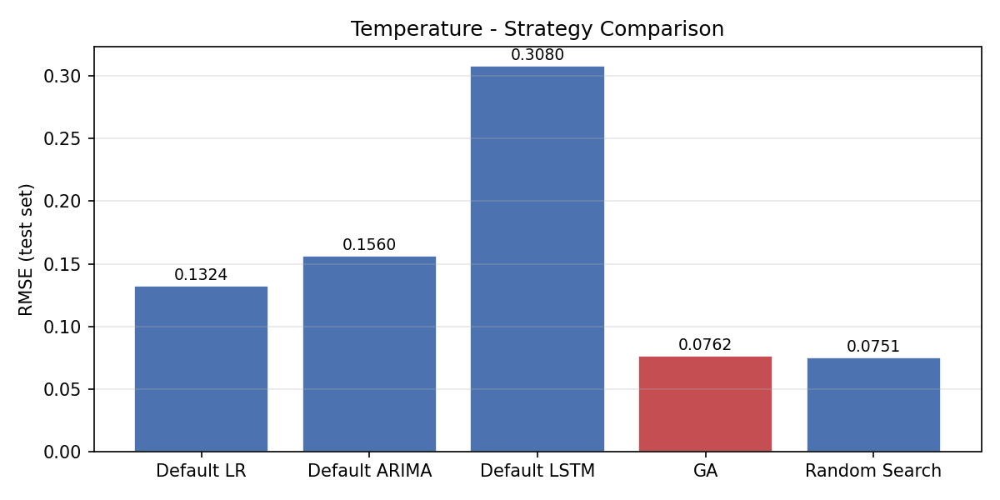
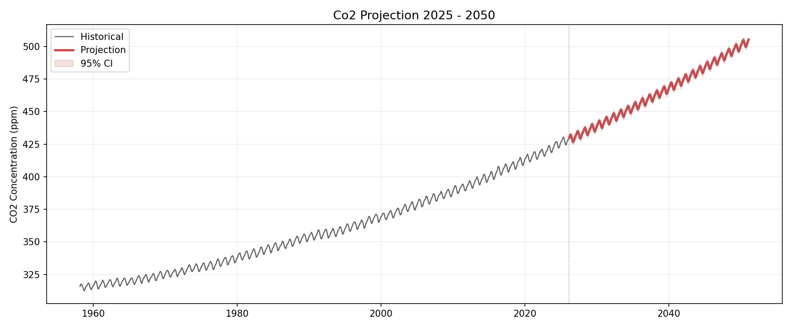

# Climate Forecasting with Genetic Algorithm Model Selection

[](https://github.com/aniketnandi/GA-Climate-Prediction/actions/workflows/ci.yml)


[](LICENSE)

A genetic algorithm that **jointly chooses the model family and tunes its hyperparameters** for climate time-series forecasting. Each run compares the GA against untuned defaults and an equal-budget random search.

**Authors:** Aniket Nandi, Akshay Ashok Bannatti. Final project for CS5100 *Foundations of Artificial Intelligence*, Northeastern University.
📄 **[Read the full paper (PDF)](Aniket_Akshay_Final_Paper.pdf)**

<p align="center">
  
  
</p>

## Highlights

- **One chromosome = one full pipeline.** Each gene string encodes a model type (Ridge regression, seasonal ARIMA or LSTM) plus that model's hyperparameters, so selection and tuning are searched together.
- **Type-aware genetic operators.** Uniform crossover only swaps genes between parents of the same model type. Mutation is either *parametric* (resample one hyperparameter) or *structural* (switch model family).
- **Fitness that penalizes complexity:** `1 / (RMSE + λ · complexity)`, with RMSE from a 24-month out-of-sample forecast.
- **A fair comparison.** The GA is benchmarked against untuned defaults and against random search given exactly the same number of model evaluations.

## Results

Population 10, 10 generations (100 evaluations per strategy), seed 42. RMSE is on the final 24 months.

| Series | GA | Random search | Best default | Tuned vs default |
|---|---:|---:|---:|---:|
| Global temperature anomaly (°C) | 0.0762 | **0.0751** | 0.1324 | −43% |
| CO₂, Mauna Loa (ppm) | 0.3163 | **0.2974** | 0.7792 | −62% |
| Sea level, global (mm)† | 2.1934 | **1.9838** | 2.6057 | −24% |
| Sea level, Indian Ocean (mm)† | 2.3164 | **2.2338** | 2.7360 | −18% |
| Sea level, Bay of Bengal (mm)† | **2.2471** | 2.3273 | 2.9184 | −23% |
| Sea level, Arabian Sea (mm)† | 2.1479 | **1.9756** | 2.5536 | −23% |

"Tuned vs default" compares the better of GA and random search with the best untuned model. † These rows use synthetic data; see [Limitations](#limitations).

**What we learned**

1. **Tuning matters more than model choice.** Automated search cut RMSE by 18–62% relative to default hyperparameters on every series.
2. **Seasonal ARIMA wins on small monthly series.** The GA picked SARIMA (s = 12) every time. Random search did too, except on CO₂, where a 36-lag ridge regression came out ahead. LSTMs were held back by the complexity penalty and by having only a few hundred to ~1,700 observations to learn from.
3. **At 100 evaluations, random search is a tough baseline.** It beat the GA on 5 of 6 series, by 1.4–9.6%. This is a known result for small search budgets, and the paper discusses when the GA's selection pressure should start to pay off.

## Limitations

These are known limitations of the reported numbers:

- **Sea-level series are synthetic.** The temperature (NASA GISTEMP v4) and CO₂ (NOAA Mauna Loa) series are real observations, downloaded at run time. For sea level, the reported run used the loader's synthetic fallback series, because the remote source was unreachable or only annual. The three Indian Ocean "regions" are that global series with a regional scale and offset applied. Treat the sea-level rows as a test of the optimizer, not as findings about real sea level. The loader prints a warning whenever it falls back to synthetic data.
- **The same window selects and scores the models.** Each candidate is fit on all data before the final 24 months, then forecasts those 24 months in one multi-step run. That RMSE is both the GA's fitness and the number reported above, with no separate validation window. The tuned results are therefore somewhat optimistic relative to truly unseen data. The comparison with random search is still fair, because both strategies share this setup.
- **The search budget is small.** 100 evaluations per strategy is too few for the GA's selection and crossover to pay off, which the paper discusses.
- **Projections are illustrative.** Projections to 2050 are statistical extrapolations, not physical climate projections. For example, the stationary (d = 0) SARIMA chosen for temperature reverts toward its mean over long horizons.

## How it works

| Component | Design |
|---|---|
| Chromosome | `model_type ∈ {LR, ARIMA, LSTM}` + hyperparameter dict ([`ga/chromosome.py`](ga/chromosome.py)) |
| Fitness | `1 / (RMSE + complexity_penalty)`, higher is better |
| Selection | Tournament, k = 3 |
| Crossover | Type-aware uniform crossover ([`ga/crossover.py`](ga/crossover.py)) |
| Mutation | Parametric (per gene, rate 0.2) + structural (model switch, rate 0.05) |
| Elitism | Top 2 carried forward unchanged |
| Baseline | Random search with an identical evaluation budget ([`ga/random_search.py`](ga/random_search.py)) |

Search spaces:

- **Ridge regression:** look-back window, α, differencing order.
- **SARIMA:** (p, d, q)(P, D, Q)₁₂.
- **LSTM:** depth, units, dropout, learning rate, batch size, epochs, early-stopping patience. If TensorFlow is unavailable, it falls back to a ridge surrogate.

## Quick start

Requires Python 3.10+ and an internet connection, because the data is downloaded from NASA and NOAA at run time. Tested on Python 3.13.

```bash
git clone https://github.com/aniketnandi/GA-Climate-Prediction.git
cd GA-Climate-Prediction
python -m venv .venv && source .venv/bin/activate   # Windows: .venv\Scripts\activate
pip install -r requirements.txt                     # ~1 min, no TensorFlow

# Smoke test: one series, tiny GA (~20 s on a laptop CPU)
python main.py --indicator temperature --pop 2 --gens 2 --quiet

# Unit tests (~5 s, offline)
pip install pytest && pytest -q
```

You should see RMSEs for the default models, the GA and random search, followed by a ranked comparison. The run writes plots and a JSON summary to `results/`.

**What to expect:**
- **Runs overwrite figures.** A run replaces the committed figures in `results/` for that series. `git checkout -- results` restores them.
- **Synthetic fallback.** If a data source can't be reached, the loader prints `WARNING: using synthetic ... data` and continues on a synthetic series.
- **LSTM without TensorFlow.** The minimal install has no TensorFlow, so LSTM candidates use a ridge-regression surrogate, and a notice is printed at startup. Install the full set for real LSTMs and the notebook (TensorFlow is large):

  ```bash
  pip install -r requirements-full.txt
  ```

Larger runs:

```bash
# Every series (temperature, CO2, four sea-level), tiny GA
python main.py --all --pop 2 --gens 2 --quiet

# Settings used for the reported results
python main.py --all --pop 10 --gens 10 --seed 42
```

To step through the notebook, which also contains a GA ablation study, install `requirements-full.txt` and then run:

```bash
jupyter notebook notebooks/climate_forecasting_ga.ipynb
```

| Flag | Default | Description |
|---|---|---|
| `--indicator` | `temperature` | `temperature`, `co2`, `sea_level`, or `all` |
| `--all` | off | Run every indicator and region |
| `--pop` | `30` | GA population size |
| `--gens` | `50` | Number of generations |
| `--seed` | `42` | Random seed |
| `--region` | `global` | Sea-level region: `global`, `indian_ocean`, `bay_of_bengal`, `arabian_sea` |
| `--quiet` | off | Suppress per-generation output |

Each run writes the following to `results/`:

- `{series}_fitness.png`: GA convergence
- `{series}_diversity.png`: model-type share per generation
- `{series}_comparison.png`: RMSE of defaults vs GA vs random search
- `{series}_projection.png`: 2025–2050 extrapolation with a 95% band
- `{series}_summary.json`: best hyperparameters and all RMSEs

## Project structure

```text
.
├── main.py                      # CLI pipeline: baselines → GA → random search → projections
├── data/loaders.py              # Download + parse GISTEMP, Mauna Loa CO2, sea level
├── models/
│   ├── statistical.py           # Ridge regression and SARIMA wrappers, metrics
│   └── lstm_model.py            # Keras LSTM (ridge fallback without TensorFlow)
├── ga/
│   ├── chromosome.py            # Encoding, search spaces, mutation, complexity penalty
│   ├── crossover.py             # Type-aware uniform crossover
│   ├── engine.py                # GA loop: tournament selection, elitism, logging
│   └── random_search.py         # Equal-budget random search baseline
├── utils/visualise.py           # Plotting helpers
├── notebooks/climate_forecasting_ga.ipynb
├── tests/                       # Unit tests for GA operators, models, loaders (pytest)
├── results/                     # Figures + JSON summaries from the reported run
└── Aniket_Akshay_Final_Paper.pdf
```

## License

Code is released under the [MIT License](LICENSE). The paper PDF and the downloaded datasets remain under their own terms.
